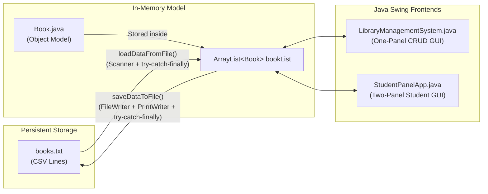

# Libra — Project & Code Documentation

## 1. Project Overview & Architecture

**Libra** is a Java Swing desktop application for managing library book records (Librarian CRUD panel) and student circulation (Borrowing, Returning, and Reserving books).

All source files belong to the `frontend` package inside [`src/frontend/`](src/frontend/) and share a single persistent text file, [`books.txt`](books.txt), in the project root.



---

## 2. How the Model Class (`Book.java`) Works & Is Used

[`Book.java`](src/frontend/Book.java) is the core domain class representing a single book record.

### 2.1 Attributes, Domain Validation & Automatic Status Calculation
The class encapsulates **6 private fields** (`src/frontend/Book.java`, lines 4–9):
- `bookId` (`String`) — Unique identifier (e.g., `"B-1001"`)
- `title` (`String`) — Book title
- `author` (`String`) — Author name
- `category` (`String`) — Genre/category
- `copies` (`int`) — Number of available copies
- `status` (`String`) — Automatically computed field (`"Available"` or `"Out of stock"`)

When a `Book` object is constructed (`src/frontend/Book.java`, lines 11–24), the constructor validates the arguments (throwing `IllegalArgumentException` if `bookId` is empty or `copies < 0`) and automatically computes `this.status` using `calculateStatus(int count)`:

```java
public Book(String bookId, String title, String author, String category, int copies) {
    if (bookId == null || bookId.trim().isEmpty()) {
        throw new IllegalArgumentException("Book ID cannot be empty");
    }
    if (copies < 0) {
        throw new IllegalArgumentException("Copies cannot be negative");
    }
    this.bookId = bookId;
    this.title = title;
    this.author = author;
    this.category = category;
    this.copies = copies;
    this.status = calculateStatus(this.copies);
}

private String calculateStatus(int count) {
    if (count > 0) {
        return "Available";
    }
    return "Out of stock";
}
```

### 2.2 How `Book` Objects Are Used Across the Project
1. **In-Memory Storage (`ArrayList<Book> bookList`)**:
   Both [`LibraryManagementSystem.java`](src/frontend/LibraryManagementSystem.java) (line 38) and [`StudentPanelApp.java`](src/frontend/StudentPanelApp.java) (line 40) maintain `private ArrayList<Book> bookList = new ArrayList<>();`. Every row in the Swing `JTable` corresponds at the same index `i` to `bookList.get(i)`.
2. **Populating the `JTable` (`addRow`)**:
   Whenever a `Book` is created (either loaded from [`books.txt`](books.txt) or added via the form), `addRow(Book book)` appends the `Book` object to `bookList` and uses its getter methods (`getBookId()`, `getTitle()`, `getAuthor()`, `getCategory()`, `getCopies()`, `getStatus()`) to add a row to `DefaultTableModel`.
3. **Updating Copy Counts (`setCopies`)**:
   In [`StudentPanelApp.java`](src/frontend/StudentPanelApp.java), when a student borrows or returns a book, `book.setCopies(...)` (`src/frontend/Book.java`, lines 57–63) checks that `copies >= 0` (throwing `IllegalArgumentException` otherwise), updates `copies`, and automatically recalculates `status` (`"Available"` vs `"Out of stock"`).

---

## 3. How File Reading & Writing (`books.txt`) Works

All persistent data is stored in [`books.txt`](books.txt) as comma-separated lines (`Book ID,Title,Author,Category,Copies`):

```text
B-1001,The Overstory,Richard Powers,Fiction,3
B-1002,Sapiens,Yuval Noah Harari,History,4
B-1003,Braiding Sweetgrass,Robin Wall Kimmerer,Nature,0
B-1004,The Design of Everyday Things,Don Norman,Design,2
```

### 3.1 Reading from `books.txt` at Startup (`loadDataFromFile`)
Called inside the constructor of both [`LibraryManagementSystem.java`](src/frontend/LibraryManagementSystem.java) (lines 221–258) and [`StudentPanelApp.java`](src/frontend/StudentPanelApp.java) (lines 248–285):
1. Checks if `new File("books.txt")` exists.
2. Opens a `java.util.Scanner` inside a `try-catch-finally` block to read the file line by line.
3. Splits each non-empty line on `","` (`String[] parts = line.split(",")`).
4. Uses an inner `try-catch (NumberFormatException | IllegalArgumentException ex)` block when parsing `Integer.parseInt(parts[4].trim())` and constructing `new Book(...)`, so any malformed line in `books.txt` is safely skipped with an alert rather than crashing the application startup.
5. Catches `FileNotFoundException` and general `Exception` for file-level errors, and guarantees `scanner.close()` in the `finally` block.

```java
private void loadDataFromFile() {
    File file = new File("books.txt");
    if (!file.exists()) {
        return;
    }

    Scanner scanner = null;
    try {
        scanner = new Scanner(file);
        while (scanner.hasNextLine()) {
            String line = scanner.nextLine().trim();
            if (line.length() > 0) {
                String[] parts = line.split(",");
                if (parts.length >= 5) {
                    try {
                        String id = parts[0].trim();
                        String title = parts[1].trim();
                        String author = parts[2].trim();
                        String category = parts[3].trim();
                        int copies = Integer.parseInt(parts[4].trim());
                        Book book = new Book(id, title, author, category, copies);
                        addRow(book);
                    } catch (NumberFormatException ex) {
                        JOptionPane.showMessageDialog(this, "Skipping invalid number in books.txt: " + ex.getMessage());
                    } catch (IllegalArgumentException ex) {
                        JOptionPane.showMessageDialog(this, "Skipping invalid record in books.txt: " + ex.getMessage());
                    }
                }
            }
        }
    } catch (FileNotFoundException e) {
        JOptionPane.showMessageDialog(this, "File books.txt not found: " + e.getMessage());
    } catch (Exception e) {
        JOptionPane.showMessageDialog(this, "Error reading from text file: " + e.getMessage());
    } finally {
        if (scanner != null) {
            scanner.close();
        }
    }
}
```

### 3.2 Writing Updates to `books.txt` (`saveDataToFile`)
Handled by `saveDataToFile(boolean showMessage)` in [`LibraryManagementSystem.java`](src/frontend/LibraryManagementSystem.java) (lines 261–280) and [`StudentPanelApp.java`](src/frontend/StudentPanelApp.java) (lines 288–307):

```java
private void saveDataToFile(boolean showMessage) {
    PrintWriter pw = null;
    try {
        FileWriter fw = new FileWriter("books.txt");
        pw = new PrintWriter(fw);
        for (int i = 0; i < bookList.size(); i++) {
            Book book = bookList.get(i);
            pw.println(book.getBookId() + "," + book.getTitle() + "," + book.getAuthor() + "," + book.getCategory() + "," + book.getCopies());
        }
        if (showMessage) {
            JOptionPane.showMessageDialog(this, "Table data saved to books.txt");
        }
    } catch (IOException e) {
        JOptionPane.showMessageDialog(this, "Error saving data to text file: " + e.getMessage());
    } finally {
        if (pw != null) {
            pw.close();
        }
    }
}
```

- **How it works**: `FileWriter("books.txt")` wrapped in a `PrintWriter` iterates through every `Book` object currently in `bookList` and writes its fields separated by commas, catching `IOException` and closing `PrintWriter` in the `finally` block.
- **When it runs**:
  - **Automatically (`showMessage = false`)**: Triggered immediately after `addBook()`, `updateBook()`, `deleteBook()`, `borrowBook()`, and `returnBook()` so any change in the table is immediately persisted.
  - **Manually (`showMessage = true`)**: Triggered when the user clicks the **Save** button, showing a confirmation popup (`"Table data saved to books.txt"`).

---

## 4. Exception Handling Architecture

The project uses structured `try-catch-finally` blocks and standard Java exceptions across both the model and GUI layers:

| Exception Type | Where Thrown / Caught | Purpose |
| :--- | :--- | :--- |
| `IllegalArgumentException` | Thrown & caught in `Book`, `addBook()`, `updateBook()`, `deleteBook()`, `searchBook()`, `borrowBook()`, `returnBook()`, `reserveBook()` | Enforces business rules and input validation: non-empty fields, ID length ≤ 10 characters, unique Book ID, non-negative copies, row selection required before Update/Delete/Return, and stock availability before borrowing. |
| `NumberFormatException` | Thrown by `Integer.parseInt(copiesText)` and caught in `addBook()`, `updateBook()`, and `loadDataFromFile()` | Catches non-numeric input in the `Copies` field (or corrupted copy counts in `books.txt`) and displays `"Copies must be a valid whole number"`. |
| `FileNotFoundException` | Caught in `loadDataFromFile()` | Handles missing `books.txt` when opening the `Scanner`. |
| `IOException` | Caught in `saveDataToFile(boolean showMessage)` | Handles disk or file permission errors when writing to `books.txt` with `FileWriter` / `PrintWriter`. |
| `IndexOutOfBoundsException` | Caught in `deleteBook()` | Guards against invalid row index removal from `bookList` or `tableModel`. |
| `finally` Block | Used in `loadDataFromFile()` and `saveDataToFile(...)` | Ensures file streams (`Scanner` and `PrintWriter`) are always closed even if an exception occurs. |

---

## 5. Code Breakdown by Function

### 5.1 One-Panel System: [`LibraryManagementSystem.java`](src/frontend/LibraryManagementSystem.java)

| Method / Code Block | Lines | Responsibility & Exceptions Handled |
| :--- | :--- | :--- |
| `LibraryManagementSystem()` | `45–166` | Builds the JFrame window, `GridBagLayout` input form (`Book ID`, `Title`, `Author`, `Category`, `Copies`), action buttons (`Add`, `Search`, `Update`, `Delete`, `Save`, `Clear`), `JTable`, calls `loadDataFromFile()`, and attaches a `MouseAdapter` to copy selected row values into the text fields. |
| `addFormRow(...)` & `createButton(...)` | `169–200` | UI helper methods for placing label/field pairs in `GridBagLayout` and styling colored buttons. |
| `actionPerformed(ActionEvent e)` | `204–218` | Central `ActionListener` dispatcher routing button clicks to `addBook()`, `searchBook()`, `updateBook()`, `deleteBook()`, `saveDataToFile(true)`, or `clearFields()`. |
| `loadDataFromFile()` & `saveDataToFile(...)` | `221–280` | Reads/writes `books.txt` using `try-catch-finally`, handling `FileNotFoundException`, `IOException`, `NumberFormatException`, and `IllegalArgumentException`. |
| `addBook()` | `295–341` | Inside a `try-catch` block: throws `IllegalArgumentException` if any field is empty, `Book ID` length > 10, `Book ID` already exists in `bookList`, or `Copies` > 7 digits. Parses `Copies` with `Integer.parseInt` (catching `NumberFormatException`), constructs `new Book(...)`, adds to `bookList` and `tableModel`, and saves to `books.txt`. |
| `searchBook()` | `344–381` | Throws and catches `IllegalArgumentException` if both `Book ID` and `Title` are blank; otherwise searches `bookList`, selects the matching row in `bookTable`, and populates the form fields. |
| `updateBook()` | `384–445` | Inside a `try-catch` block: throws `IllegalArgumentException` if no row is selected (`row == -1`), fields are empty, `Book ID` > 10 chars, or another row (`i != row`) already uses the same `Book ID`. Catches `NumberFormatException` on invalid `Copies`, updates `bookList` and `tableModel`, and writes to `books.txt`. |
| `deleteBook()` | `448–475` | Throws `IllegalArgumentException` if no row is selected, prompts a `JOptionPane.YES_NO_OPTION` confirmation dialog, removes the record from `bookList` and `tableModel`, and updates `books.txt` (catching `IllegalArgumentException | IndexOutOfBoundsException`). |
| `clearFields()` | `478–485` | Deselects any table row and resets all 5 input text fields. |

---

### 5.2 Two-Panel System: [`StudentPanelApp.java`](src/frontend/StudentPanelApp.java)

| Method / Code Block | Lines | Responsibility & Exceptions Handled |
| :--- | :--- | :--- |
| `StudentPanelApp()` | `48–193` | Builds the two-panel interface: top form (`Student ID`, `Student Name`, `Book ID`, `Search Title`), action buttons (`Search`, `Borrow`, `Return`, `Reserve`, `Save`, `Clear`), and a 2-row `GridLayout` holding the **Available Books Catalogue** table on top and **My Borrowed & Reserved Books** table on the bottom. |
| `loadDataFromFile()` & `saveDataToFile(...)` | `248–307` | Loads the book catalogue from `books.txt` into `bookList` and `catalogueModel` on startup and writes updated copy counts back to `books.txt` with `try-catch-finally` exception handling. |
| `borrowBook()` | `366–408` | Uses `try-catch (IllegalArgumentException ex)` to validate `Student ID` (non-empty, ≤ 10 chars), `Student Name`, `Book ID`, book existence (`row != -1`), and stock (`book.getCopies() > 0`). Decrements copies via `book.setCopies(...)`, updates the top catalogue table, appends a `"Borrowed"` record (`BR-1`, `BR-2`, ...) to the bottom table, and saves `books.txt`. |
| `returnBook()` | `411–442` | Uses `try-catch (IllegalArgumentException ex)` to verify a row with status `"Borrowed"` is selected in the bottom table, increments the corresponding book's copies via `book.setCopies(book.getCopies() + 1)`, updates the catalogue table status to `"Available"`, marks the bottom record as `"Returned"`, and saves `books.txt`. |
| `reserveBook()` | `445–478` | Uses `try-catch (IllegalArgumentException ex)` to validate student and book fields, locates the `Book` in `bookList`, and adds a `"Reserved"` entry (`RES-1`, `RES-2`, ...) to the bottom table. |
