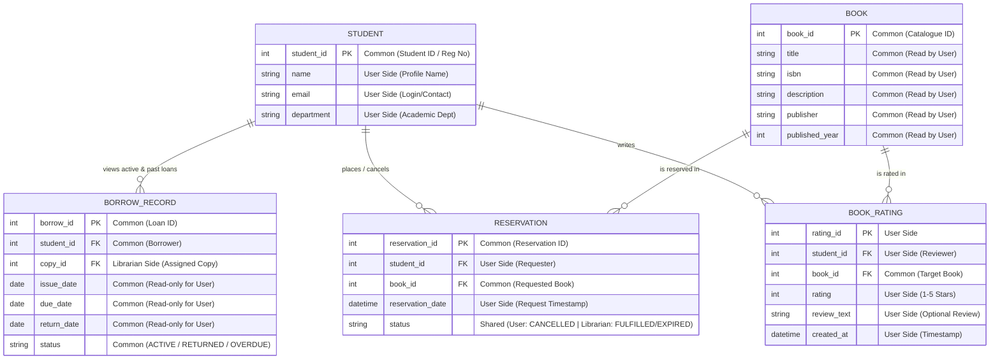
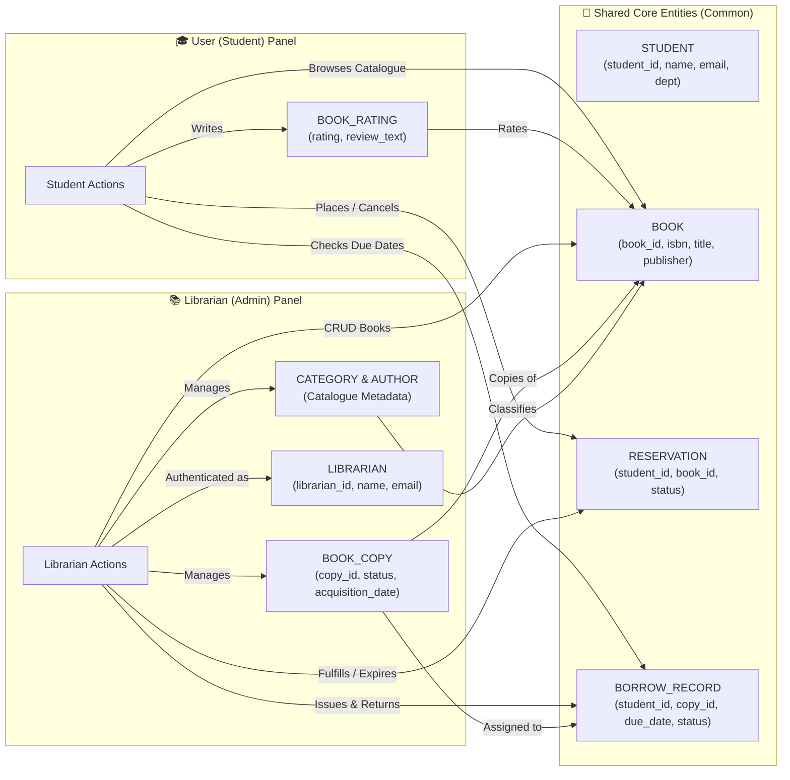

# Libra — Two-Panel Entity Relationship (ER) Design

**Libra** is a **2-Panel Library Management System**:
1. **User (Student) Panel**: Focused on browsing the catalogue, checking book availability, viewing personal borrowed books & due dates, reserving unavailable books, and rating/reviewing books.
2. **Librarian (Admin) Panel**: Focused on catalogue management (`BOOK`, `AUTHOR`, `CATEGORY`), physical copy inventory (`BOOK_COPY`), book circulation (`BORROW_RECORD` issue/return), and fulfilling student reservations (`RESERVATION`).

---

## 1. User (Student) Panel — ER Diagram

This diagram shows the entities and attributes visible to or controlled by the **Student / User side**.

---

## 2. Librarian (Admin) Panel — ER Diagram

This diagram shows the entities and attributes managed by the **Librarian side** for inventory control, cataloguing, and book circulation.

```mermaid
erDiagram
    LIBRARIAN {
        int librarian_id PK "Librarian Side (Staff ID)"
        string name "Librarian Side (Staff Name)"
        string email "Librarian Side (Staff Email)"
    }

    BOOK {
        int book_id PK "Common (Catalogue ID)"
        string title "Librarian Side (Created/Edited)"
        string isbn "Librarian Side (Created/Edited)"
        string description "Librarian Side (Created/Edited)"
        string publisher "Librarian Side (Created/Edited)"
        int published_year "Librarian Side (Created/Edited)"
    }

    BOOK_COPY {
        int copy_id PK "Librarian Side (Physical Copy ID)"
        int book_id FK "Common (Parent Book)"
        string status "Librarian Side (AVAILABLE/ISSUED/MAINTENANCE/LOST)"
        date acquisition_date "Librarian Side (Inventory Date)"
    }

    AUTHOR {
        int author_id PK "Librarian Side"
        string name "Librarian Side (Author Name)"
    }

    CATEGORY {
        int category_id PK "Librarian Side"
        string name "Librarian Side (Category/Genre)"
        string description "Librarian Side"
    }

    BOOK_AUTHOR {
        int book_id PK, FK "Librarian Side"
        int author_id PK, FK "Librarian Side"
    }

    BOOK_CATEGORY {
        int book_id PK, FK "Librarian Side"
        int category_id PK, FK "Librarian Side"
    }

    BORROW_RECORD {
        int borrow_id PK "Common (Loan ID)"
        int student_id FK "Common (Verified Student)"
        int copy_id FK "Librarian Side (Physical Copy Issued)"
        date issue_date "Librarian Side (Set on Issue)"
        date due_date "Librarian Side (Set on Issue)"
        date return_date "Librarian Side (Set on Return)"
        string status "Librarian Side (ACTIVE / RETURNED / OVERDUE)"
    }

    RESERVATION {
        int reservation_id PK "Common"
        int student_id FK "Common (Requester)"
        int book_id FK "Common (Target Book)"
        datetime reservation_date "User Side (Created)"
        string status "Librarian Side (Updates to FULFILLED / EXPIRED)"
    }

    STUDENT {
        int student_id PK "Common (Looked up by Librarian)"
        string name "Common (Verified by Librarian)"
        string email "Common (Contact for Overdue/Reservation)"
        string department "Common"
    }

    %% Librarian Panel Relationships
    LIBRARIAN ||--o{ BORROW_RECORD : "issues & processes returns"
    LIBRARIAN ||--o{ BOOK_COPY : "manages inventory"

    BOOK ||--o{ BOOK_COPY : "has physical copies"
    BOOK ||--o{ BOOK_AUTHOR : "written by"
    AUTHOR ||--o{ BOOK_AUTHOR : "writes"
    BOOK ||--o{ BOOK_CATEGORY : "classified under"
    CATEGORY ||--o{ BOOK_CATEGORY : "groups"

    BOOK_COPY ||--o{ BORROW_RECORD : "circulated in"
    STUDENT ||--o{ BORROW_RECORD : "borrows"
    STUDENT ||--o{ RESERVATION : "holds"
    BOOK ||--o{ RESERVATION : "reserved in"
```

---

## 3. Attribute Ownership Breakdown (User vs. Librarian vs. Common)

### 3.1 Shared Entities & Common Attributes

| Entity | Attribute | Ownership / Control | User (Student) Side Role | Librarian (Admin) Side Role |
| :--- | :--- | :---: | :--- | :--- |
| **`BOOK`** | `book_id`, `isbn`, `title`, `description`, `publisher`, `published_year` | **Librarian Writes / User Reads** | **Read-Only**: Browses, searches, and views book details. | **Full CRUD**: Adds new titles, edits metadata, deletes books. |
| **`BOOK_COPY`** | `copy_id`, `book_id` | **Librarian Writes / Common Ref** | **Read-Only (Derived)**: Sees count of `AVAILABLE` copies on a book. | **Full CRUD**: Registers new physical copies. |
| **`BOOK_COPY`** | `status`, `acquisition_date` | **Librarian Side** | Hidden (only sees overall availability). | Updates status (`AVAILABLE`, `ISSUED`, `MAINTENANCE`, `LOST`). |
| **`BORROW_RECORD`** | `borrow_id`, `student_id`, `copy_id` | **Common** | Views own borrowing history & currently borrowed books. | Creates record when issuing a physical copy to a student. |
| **`BORROW_RECORD`** | `issue_date`, `due_date`, `return_date`, `status` | **Librarian Writes / User Reads** | **Read-Only**: Checks due dates and `OVERDUE` status. | **Write**: Sets `issue_date`/`due_date` at checkout; sets `return_date` & `RETURNED` status on return. |
| **`RESERVATION`** | `reservation_id`, `student_id`, `book_id`, `reservation_date` | **User Writes / Librarian Reads** | **Write**: Creates a reservation when a book has 0 available copies. | **Read**: Views the reservation queue for a book. |
| **`RESERVATION`** | `status` | **Shared Write** | Can change status from `ACTIVE` → `CANCELLED`. | Changes status from `ACTIVE` → `FULFILLED` or `EXPIRED`. |
| **`STUDENT`** | `student_id`, `name`, `email`, `department` | **Common** | Logs in (`STU-xxxx`) and views personal profile. | Looks up student ID (`STU-xxxx`) to issue/return books. |

---

### 3.2 Panel-Exclusive Entities

| Panel | Entity | Attributes | Purpose |
| :--- | :--- | :--- | :--- |
| **User Panel Only** | **`BOOK_RATING`** | `rating_id`, `student_id`, `book_id`, `rating`, `review_text`, `created_at` | Created by students to rate (1–5 stars) and review books. |
| **Librarian Panel Only** | **`LIBRARIAN`** | `librarian_id`, `name`, `email` | Staff account (`LIB-xxx`) for managing inventory and circulation. |
| **Librarian Panel Only** | **`AUTHOR` & `BOOK_AUTHOR`** | `author_id`, `name`, `book_id` | Managed by librarians when cataloguing books; students read author names on books. |
| **Librarian Panel Only** | **`CATEGORY` & `BOOK_CATEGORY`** | `category_id`, `name`, `description`, `book_id` | Managed by librarians to organize books by subject/genre; students filter by category. |

---

## 4. Unified Bridge Diagram (How Both Panels Connect)

